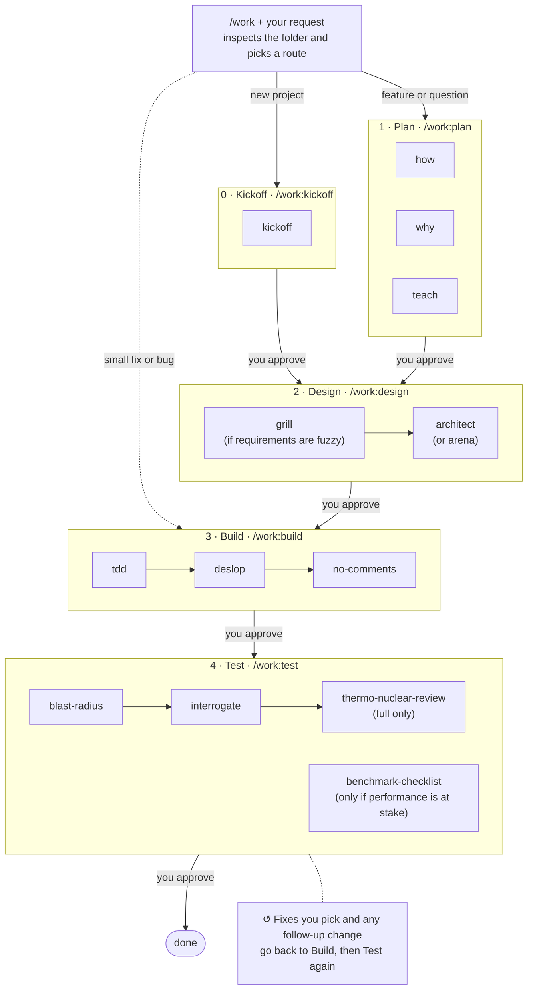

# work

A staged, approval-gated workflow for AI-assisted TypeScript/web development in Claude Code.

> If you want to go fast, go deep first.

`work` splits a change into stages. Inside a stage the agent works on its own. Between stages it stops, summarizes, and waits for your approval.

## Just ask

```
/work build me a new REST API in TypeScript
/work implement a new endpoint for listing orders
/work how does auth work here?
```

`/work` inspects the folder, decides between a new project and an existing one, announces the route it picked (for example `architect → tdd`), and runs it one stage at a time, stopping for your approval between stages. If the bare `/work` is taken by another command on your machine, use `/work:work`.

## The pipeline



- Solid arrows are stage gates: the agent stops, summarizes, and waits for you. Dotted arrows are shortcuts.
- Each box title is the skill that runs that whole stage, for example `/work:test full`. Every skill inside a box can also run on its own.
- `/work` skips what a request doesn't need and announces the route first, for example `tdd → deslop → no-comments ── gate ── test light ── gate`. A question stops at Plan.
- **Test light** is `blast-radius` → `interrogate`. **Test full** adds `thermo-nuclear-review`. Features and cleanups get full, small fixes get light.
- A change that touched code always ends at a Test gate, including follow-ups after the route is done.
- Used in every stage: `project-structure` (where code lives), `typescript-best-practices` (every `.ts`/`.tsx` edit) and `principles`.

## Stages

| Stage | Skill | What it does |
| --- | --- | --- |
| **0. Kickoff**: new projects only | `/work:kickoff` | Settles the first slice and stack, scaffolds strict TS, writes CLAUDE.md, proves it with a walking-skeleton test |
| **1. Plan**: understand the code | `/work:how` | Explains how code works, with file citations |
| | `/work:why` | Explains why it was built that way, from git history and PRs |
| | `/work:teach` | Runs `how` and `why` and teaches the result plainly |
| **2. Design**: settle the shape | `/work:grill` | Interviews you in rounds until nothing is assumed |
| | `/work:architect` | Sketches two shapes (types, signatures, ownership) and picks one |
| | `/work:arena` | Several subagents design in parallel; a judge helps pick and graft |
| **3. Build**: test-first, then clean | `/work:tdd` | Red-green in vertical slices at agreed seams |
| | `/work:typescript-best-practices` | Strict TS rules, applied automatically to `.ts`/`.tsx` |
| | `/work:deslop` | Strips AI slop from the diff without changing behavior |
| | `/work:no-comments` | Deletes needless comments and fixes the code they explained |
| **4. Test**: vet and attack the diff | `/work:blast-radius` | Finds what the change breaks outside the diff and proves the fact it's safe because of |
| | `/work:benchmark-checklist` | Vets any performance number before you trust it |
| | `/work:interrogate` | Adversary subagents try to break the change; only failures proven by a run survive |
| | `/work:thermo-nuclear-review` | A harsh maintainability review that hunts for dramatically simpler structures |

Test skills only report. You pick which findings to fix, and each fix goes back through `tdd`.

**Run a whole stage:**

| Skill | Runs |
| --- | --- |
| `/work:plan <area>` | `how`, `why` or `teach`, whichever the question needs |
| `/work:design <change>` | `grill` (if requirements are fuzzy) → `architect` (or `arena`) |
| `/work:build <change>` | `tdd` → `deslop` → `no-comments`, then hands off to Test |
| `/work:test [light\|full]` | `blast-radius` → `interrogate` (→ `thermo-nuclear-review` for full, `benchmark-checklist` if performance is at stake), one gate at the end |

Changes after a finished route go through `build` and `test` again. A turn that changed code always ends at a Test gate.

**Used across stages:**

| Skill | What it does |
| --- | --- |
| `/work:project-structure` | Where code lives. Scaffolds your preferred layout in new projects (REST API: layers, classes with constructor injection, hand-wired `container.ts`). In existing projects it finds and follows the project's own conventions, and never restructures unless you ask. |
| `/work:principles` | The rules every skill follows, such as stage gates, subtract before you add, boundary discipline and prove it works. |

## Install

```
/plugin marketplace add LgAcerbi/lgstack
/plugin install work@lgstack
```

To try it locally before publishing:

```
claude --plugin-dir ./work
```

## Not covered yet

PRs and deploy.

## Credits

Adapted from [pstack](https://github.com/cursor/plugins/tree/main/pstack) (Lauren Tan, via Michael Denyer's [pstack-claude](https://github.com/michael-denyer/pstack-claude)) and [Matt Pocock's skills](https://github.com/mattpocock/skills). See [NOTICE.md](NOTICE.md). MIT licensed.
